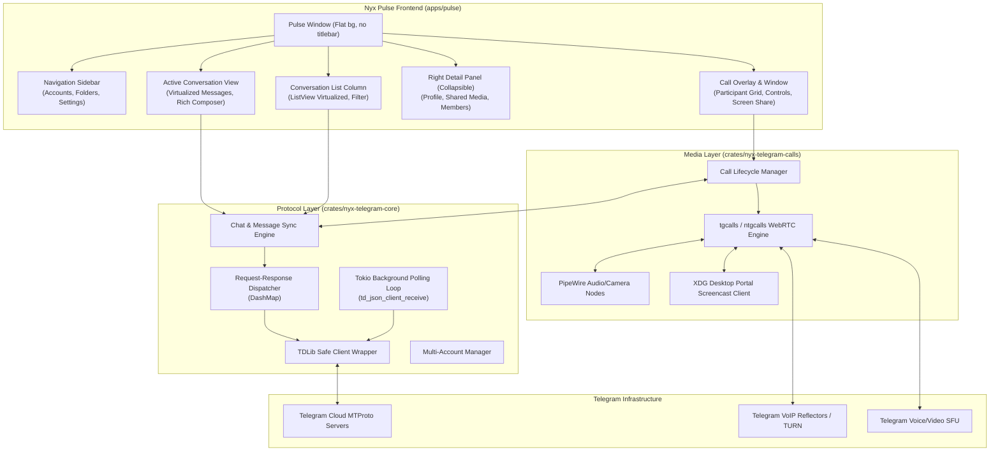

# Nyx Pulse Architecture

## 1. System Overview

**Nyx Pulse** is a native Linux Telegram desktop client written in Rust and GTK4, built specifically for the Omarchy Linux desktop and the Nyx application suite.

The system is designed with a clean architectural separation:
1. **User Interface (`nyx-pulse`)**: Native GTK4 desktop application adhering to Nyx's `STYLE.md`, providing a responsive three-column interface, virtualized message rendering, calling interfaces, settings cards, and live Omarchy theme synchronization.
2. **Protocol Engine (`nyx-telegram-core`)**: Asynchronous TDLib bridge managing client lifecycles, user authentication, multi-account persistence, chat synchronization, message dispatch, search, and event streaming.
3. **Audio/Video Media Stack (`nyx-telegram-calls`)**: Real-time VoIP and WebRTC media processing subsystem interfacing with Telegram's calling infrastructure (`tgcalls`/`ntgcalls`), Linux PipeWire audio/video pipelines, and Wayland screen capture via the XDG Desktop Portal.



---

## 2. Component Decomposition

### 2.1. `apps/pulse` (GUI Application)
- **Binary**: `nyx-pulse`
- **Application ID**: `io.github.design_nexus.nyx.Pulse`
- **Responsibilities**:
  - GTK4 application initialization and lifecycle (`nyx_core::app::init("pulse")`).
  - Window frame setup without client-side titlebars or top bars.
  - Three-column layout management:
    - Left column: Account selector, chat folders, conversation list.
    - Center column: Conversation header, message history, composer.
    - Right column: Collapsible details, contact/group info, shared media.
  - Calling interface: floating overlay, compact active call box, and full video grid.
  - Integration with `nyx-theme` (Follow Omarchy live restyling, bundled themes).
  - Integration with `nyx-ui` (settings cards, option rows, shortcuts dialog).
  - D-Bus control interface server (`nyx_core::control`) for Nyx Assistant.

### 2.2. `crates/nyx-telegram-core` (Protocol Engine)
- **Crate**: `nyx-telegram-core`
- **Responsibilities**:
  - Safe Rust FFI bindings to TDLib's C JSON API (`libtdjson.so`).
  - Tokio-based asynchronous client managing request/response correlation using `@extra` tokens.
  - Background polling worker loop (`td_json_client_receive`).
  - Authentication state machine: phone number, SMS/Telegram code, QR code generation, and 2FA cloud password.
  - Multi-account management: isolated database directories (`~/.local/share/nyx-pulse/accounts/<account_id>/`).
  - In-memory chat and user caches, typing status indicators, draft management, and offline queueing.
  - Media transfer management: background downloads, uploads, and progress monitoring.

### 2.3. `crates/nyx-telegram-calls` (Audio/Video Media Stack)
- **Crate**: `nyx-telegram-calls`
- **Responsibilities**:
  - Bridges TDLib call signaling (`CallStateReady` with encryption keys and reflector endpoints) to the media streaming engine.
  - 1-on-1 calls: P2P UDP or Telegram VoIP reflector transport with Opus audio and VP8/H.264 video.
  - Group voice and video chats: WebRTC Selective Forwarding Unit (SFU) signaling using SDP/ICE payloads.
  - Audio capture and playback via native PipeWire (or PulseAudio compatibility layer).
  - Video camera capture via PipeWire / V4L2.
  - Screen and window sharing via XDG Desktop Portal (`org.freedesktop.portal.ScreenCast`) with PipeWire stream consumption.
  - Audio device enumeration, microphone mute/unmute, and volume metering.

---

## 3. Concurrency and Async Runtime Architecture

To ensure zero UI hitching while managing high-throughput message streams and media transfers, Nyx Pulse uses a hybrid Tokio + GLib concurrency model:

```
┌────────────────────────────────────────────────────────┐
│                   GTK4 Main Loop                       │
│  - Event handling & Widget rendering (Main Thread)     │
│  - Receives state updates via glib::MainContext channel│
│  - Dispatches user actions (clicks, keypresses)        │
└────────────┬──────────────────────────────▲────────────┘
             │                              │
     User Action (Send, Load)       glib::Sender::send()
             │                              │
┌────────────▼──────────────────────────────┴────────────┐
│                  Tokio Async Runtime                   │
│  - Multi-threaded background executor                  │
│  - TDLib JSON request dispatching via oneshot channels │
│  - File download/upload streams                        │
│  - D-Bus control handlers                              │
└────────────┬──────────────────────────────▲────────────┘
             │                              │
     td_json_send()                  td_json_receive()
             │                              │
┌────────────▼──────────────────────────────┴────────────┐
│              TDLib Dedicated Worker Thread             │
│  - Synchronous blocking call:                          │
│    td_json_client_receive(client, 1.0)                 │
│  - Passes JSON strings into Tokio event channel        │
└────────────────────────────────────────────────────────┘
```

1. **GTK4 Main Thread**: Owns all UI widgets and the GLib main event loop. No blocking TDLib operations or heavy serialization run on this thread.
2. **Tokio Runtime**: Runs background async tasks, handles network I/O, secret storage access, and async D-Bus interfaces.
3. **TDLib Dedicated Receiver Thread**: Runs a continuous polling loop calling `td_json_client_receive(client, 1.0)`. As events arrive, they are decoded and forwarded immediately to Tokio tasks or directly to the GTK main loop via `glib::MainContext::channel`.

---

## 4. TDLib Integration Specification

### 4.1. FFI Binding Layer
TDLib exposes a C JSON interface with five functions:
```c
void* td_json_client_create(void);
void  td_json_client_send(void* client, const char* request);
const char* td_json_client_receive(void* client, double timeout);
const char* td_json_client_execute(void* client, const char* request);
void  td_json_client_destroy(void* client);
```

Nyx Pulse interfaces with `libtdjson.so` using dynamic library loading (`libloading`) or compile-time linking via `pkg-config`:
- **Dynamic Loading Priority**:
  1. `$TDLIB_PATH` (user-defined environment variable).
  2. `/usr/lib/libtdjson.so` or `/usr/local/lib/libtdjson.so` (from package `telegram-tdlib`).
  3. Bundled fallback in application directory if distributed as a bundle.

### 4.2. Request / Response Correlation
Every asynchronous request sent to `td_json_client_send` includes an `@extra` field containing a unique `u64` request ID:
```json
{
  "@type": "getChatHistory",
  "chat_id": -100123456789,
  "from_message_id": 0,
  "offset": 0,
  "limit": 50,
  "@extra": "42"
}
```
When TDLib outputs a JSON response with `"@extra": "42"`, the background dispatcher looks up the corresponding `tokio::sync::oneshot::Sender<Value>` in a thread-safe `DashMap<u64, oneshot::Sender>` and completes the future.

### 4.3. Update Pipeline
Messages, user states, chat orders, and call updates arrive without an `@extra` field. These are parsed into typed Rust events (`Update::NewMessage`, `Update::ChatLastMessage`, `Update::UserStatus`, `Update::Call`) and broadcast across the event bus to subscribed UI components.

---

## 5. Voice and Video Calling Architecture

### 5.1. Telegram Calling Protocols
Telegram uses two distinct architectures for calls:
1. **1-on-1 Calls (Private Calls)**:
   - Signaling: TDLib (`createCall`, `acceptCall`, `discardCall`, `sendCallSignalingData`).
   - Key Exchange: Diffie-Hellman key exchange negotiated during signaling. Result is a shared 256-bit encryption key.
   - Verification: Four emojis derived from `SHA256(encryption_key)` displayed on both ends to prevent man-in-the-middle attacks.
   - Transport: Direct UDP peer-to-peer (P2P) if network NAT allows, falling back to Telegram VoIP reflectors (proxies).
   - Codecs: Opus for audio, VP8/H.264 for video.
2. **Group Calls & Video Chats**:
   - Signaling: TDLib (`joinGroupCall`, `leaveGroupCall`, `toggleGroupCallMute`, `toggleGroupCallScreenSharing`).
   - Media Topology: Telegram Selective Forwarding Unit (SFU) servers.
   - Protocol: WebRTC SDP and ICE negotiation encapsulated in JSON payloads exchanged via TDLib.
   - Codecs: Opus for audio, VP8/VP9/AV1 for video.

### 5.2. Media Engine Integration (`nyx-telegram-calls`)
To achieve true native calling without relying on external conferencing platforms (e.g., Matrix or Jitsi), `nyx-telegram-calls` wraps Telegram's native C++ calling engine (`tgcalls`/`ntgcalls`):
- **C++ FFI Bridge**: C++ classes are wrapped with a stable C ABI (`ntgcalls-sys`) or `cxx` bridge.
- **Audio I/O**: Direct integration with Linux PipeWire via the PulseAudio/PipeWire layer or native `libpipewire`, providing lowest-latency capture and playback.
- **Video Input**: V4L2 and PipeWire camera capture pipelines.
- **Screen Sharing**: Calls `org.freedesktop.portal.ScreenCast` over D-Bus via `ashpd`, captures the PipeWire video stream node, and injects frames into the WebRTC video track.

---

## 6. Native GTK4 UI Architecture

### 6.1. Layout Structure
Adhering to `STYLE.md`, the window consists of:
- **Frame (`.window-frame`)**: Vertical box containing the main body and the 34 px status bar.
- **No Window Chrome**: Titlebar is set to an empty horizontal box (`window.set_titlebar(Some(&gtk::Box::new()))`). Window controls and tiling are managed by Hyprland.
- **Three-Column Body**:
  1. **Navigation Sidebar (`.settings-navigation`)**: 250 px width (`hexpand(false)`), collapsible to 52 px compact mode below 980 px window width or via <kbd>Ctrl</kbd>+<kbd>B</kbd>. Contains the sidebar head (`chrome::sidebar_head`), account switcher, and chat folders.
  2. **Conversation List**: 300 px width, holding the search entry (<kbd>Ctrl</kbd>+<kbd>F</kbd>), filter chips, and the virtualized chat list.
  3. **Active Chat / Center Column**: Expanding column (`hexpand(true)`), holding the chat header, the virtualized message list, and the composer.
  4. **Right Detail Column (Optional)**: Collapsible sidebar (320 px) showing profile details, shared media, group members, and notification settings.

### 6.2. List Virtualization
To ensure smooth scrolling and low memory usage even with tens of thousands of messages:
- **`gtk::ListView` + `gio::ListStore`**: Message bubbles are rendered dynamically using `gtk::SignalListItemFactory`. Widgets are recycled as messages scroll off-screen.
- **Windowed Message Fetching**: History is loaded in chunks of 50 messages on demand as the user approaches the top edge of the scroll area.
- **No Visible Scrollbars**: All scrolled windows use `gtk::PolicyType::External` or `Never`, and CSS hides scrollbars completely in compliance with `STYLE.md`.

---

## 7. Security and Storage Architecture

1. **Telegram API Credentials**:
   Users supply their own `api_id` and `api_hash` (or load them from the environment). Stored securely via Linux Secret Service (`org.freedesktop.secrets` through the `oo7` crate).
2. **TDLib Database Encryption**:
   Each account's TDLib SQLite database is encrypted with a unique 256-bit encryption key stored in the Linux Secret Service keyring.
3. **Data Directories**:
   - Configuration: `~/.config/nyx-pulse/`
   - State & Accounts: `~/.local/state/nyx-pulse/`
   - Data & Cache: `~/.local/share/nyx-pulse/accounts/<id>/`
   - Cache (Media): `~/.cache/nyx-pulse/`
4. **Log Privacy**:
   All sensitive payloads (authentication codes, passwords, private message contents) are scrubbed from logs.
